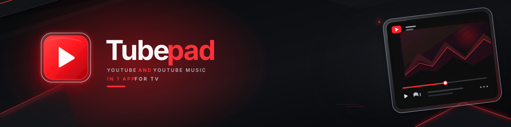
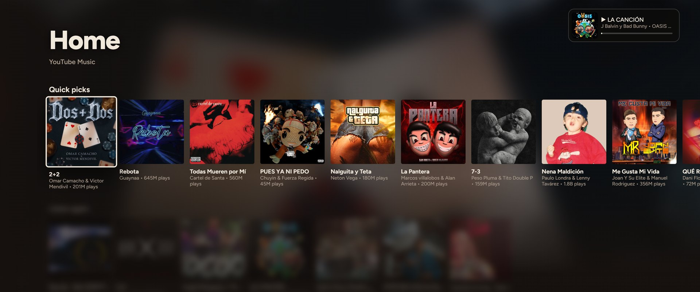
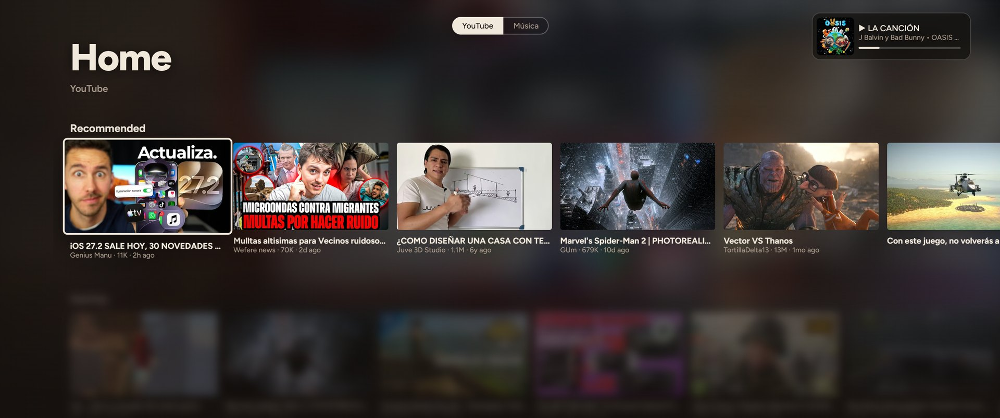
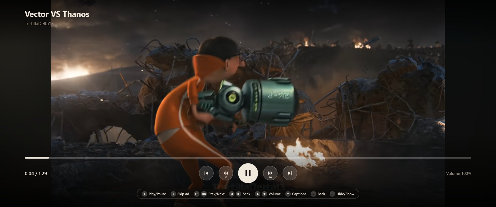
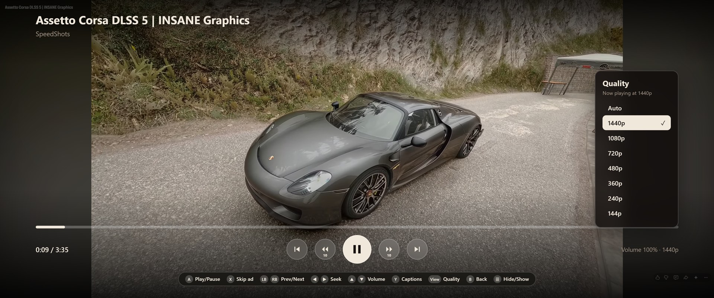
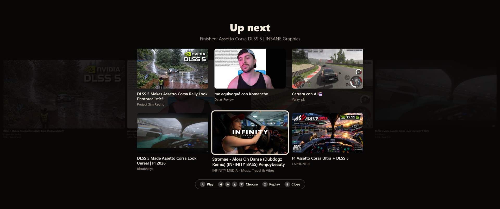
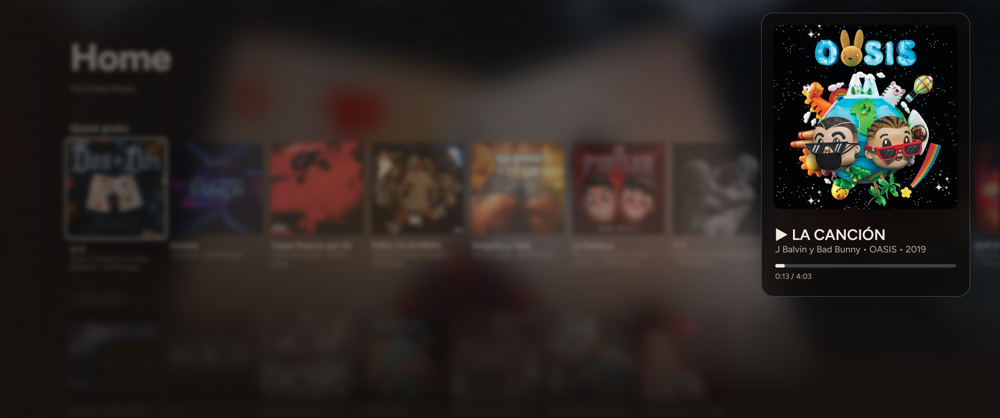
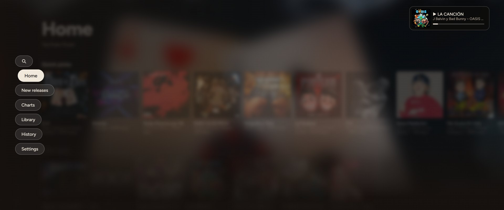
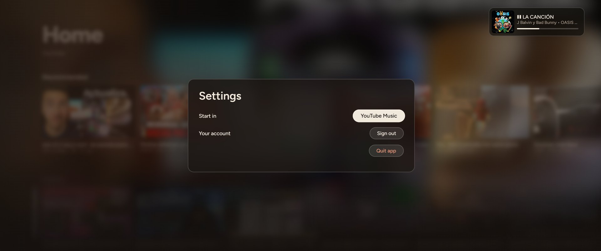
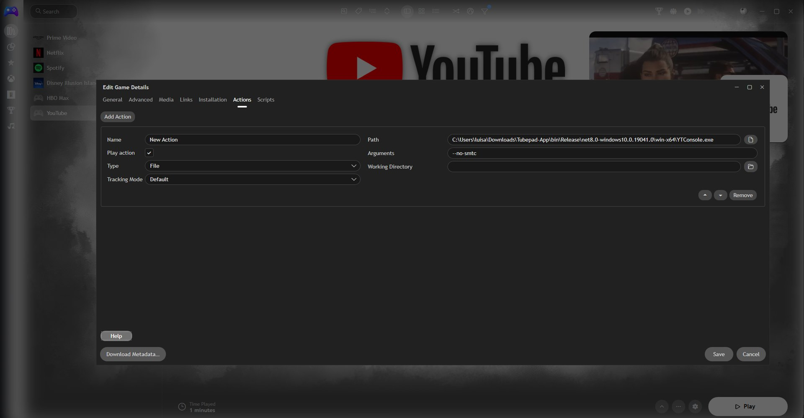

<p align="center"></p>

# Tubepad

[](https://paypal.me/Valadal)
[](#support-the-project)

A **YouTube and YouTube Music** interface made for TVs and game controllers, including Xbox and PlayStation. You can also use it with a keyboard.

Tubepad is a small **Windows app**. You download it, open it, sign in, and use it with your controller.

> Unofficial project. Not affiliated with Google or YouTube. YouTube is a trademark of Google LLC.

<p align="center"></p>

## Features

- Watch YouTube videos and listen to YouTube Music, all from one screen.
- Switch between **YouTube** and **Music** with one button.
- Search with an on-screen keyboard.
- Your Home, subscriptions, playlists, liked videos, watch later and history.
- Full-screen video player with its own controls. You can skip ads with a button.
- Choose the **video quality** (up to the maximum YouTube offers). Tubepad remembers your choice.
- When a video ends, an **Up next** screen shows suggested videos you can pick with the controller.
- Music keeps playing while you browse, with a "now playing" bar and a big cover view.
- Windows media controls: song, cover art and play/pause/next/previous buttons show in Windows.
- Works with [Playnite](https://playnite.link) like any other game.

## Screenshots

<table>
  <tr>
    <td width="50%"><br><sub>YouTube</sub></td>
    <td width="50%"><br><sub>Video player</sub></td>
  </tr>
  <tr>
    <td width="50%"><br><sub>Video quality</sub></td>
    <td width="50%"><br><sub>Up next</sub></td>
  </tr>
  <tr>
    <td width="50%"><br><sub>Now playing</sub></td>
    <td width="50%"><br><sub>Menu</sub></td>
  </tr>
  <tr>
    <td colspan="2"><br><sub>Settings</sub></td>
  </tr>
</table>

## Install

1. Go to **[Releases](https://github.com/valadal/Tubepad/releases/latest)** and download `Tubepad-win-x64.zip`.
2. Extract the zip to a folder you will keep, for example `C:\Apps\Tubepad`. Don't run it from inside the zip.
3. Open `YTConsole.exe`.
4. The first time, Windows may say "Windows protected your PC" because the app isn't code-signed. Click **More info → Run anyway**.
5. Press **A** (or Enter) on the sign-in screen and log in with your Google account. You only do this once.

**You need:**

- Windows 10 (version 2004) or newer.
- The Microsoft Edge **WebView2 Runtime**. Windows 11 and most updated Windows 10 PCs already have it. If the app says it's missing, [download it here](https://developer.microsoft.com/microsoft-edge/webview2/).
- An internet connection.

You don't need to install .NET. It's already inside the download.

Your sign-in stays **only on your PC** (in `%LocalAppData%\YTConsole`). Nothing is sent to anyone else. To log out, open **Settings → Sign out**.

To close the app, open **Settings → Quit app**.

## Controls

Press **Menu ☰ / OPTIONS** or the `H` key to see the controls on screen.

### Browsing

| Action | Xbox | PlayStation | Keyboard |
|---|---|---|---|
| Move | D-pad / left stick | D-pad / left stick | Arrow keys |
| Select / play | A | ✕ | Enter |
| Back / open menu | B | ○ | Esc or Backspace |
| Switch YouTube / Music | Y | △ | M or Y |
| Play / pause music | X | □ | Space |
| Previous / next song | LB / RB | L1 / R1 | P / N |
| Seek in the song | Right stick ←→ | Right stick ←→ | [ / ] |
| Big cover (now playing) | View | CREATE | V |
| Show controls | Menu ☰ | OPTIONS | H |

### Video player

| Action | Xbox | PlayStation | Keyboard |
|---|---|---|---|
| Play / pause | A | ✕ | Enter or Space |
| Skip ad | X | □ | X |
| Previous / next video | LB / RB | L1 / R1 | P / N |
| Go back / forward 10 seconds | D-pad ←→ | D-pad ←→ | ← / → |
| Go back / forward 5 seconds | Right stick ←→ | Right stick ←→ | — |
| Volume | D-pad ↑↓ | D-pad ↑↓ | ↑ / ↓ |
| Captions | Y | △ | C |
| Video quality | View | CREATE | Q |
| Close the video | B | ○ | Esc or Backspace |
| Show / hide controls | Menu ☰ | OPTIONS | H |

### Video quality

Press **View** while watching a video to open the quality list. Choose **Auto** to let YouTube decide, or a fixed quality such as 1080p. Your choice is remembered and applied to every new video.

| Action | Xbox | PlayStation | Keyboard |
|---|---|---|---|
| Open the list | View | CREATE | Q |
| Move | D-pad ↑↓ | D-pad ↑↓ | ↑ / ↓ |
| Choose | A | ✕ | Enter |
| Close | B | ○ | Esc or Backspace |

### Up next (when a video ends)

| Action | Xbox | PlayStation | Keyboard |
|---|---|---|---|
| Move between videos | D-pad | D-pad | Arrow keys |
| Play the selected video | A | ✕ | Enter |
| Watch it again | X | □ | X |
| Close the player | B | ○ | Esc or Backspace |

If the video is part of a playlist, Tubepad goes on to the next one as usual.

## Add Tubepad to Playnite

1. In Playnite, add a new game with **Add Game → Manually**, or open the "YouTube" entry you already have and choose **Edit**.
2. On the **General** tab, set the name (for example "Tubepad") and add a cover or background if you like.
3. Open the **Actions** tab and click **Add Action**.
4. Fill it in like this:

   | Field | Value |
   |---|---|
   | Type | **File** |
   | Path | Browse to `YTConsole.exe` |
   | Arguments | `--no-smtc` |
   | Working Directory | Leave empty |
   | Play action | Checked |
   | Tracking Mode | **Default** |

5. Click **Save** and launch it from Playnite Desktop or Fullscreen mode.

This is how it should look:

<p align="center"></p>

**Why `--no-smtc`?** Without it, Windows can show two media sessions (one from the app and one from the browser inside it), and some Playnite themes with a media player get confused. With `--no-smtc` only one session is left and your theme reads it correctly.

Good to know:

- Only one copy runs at a time. If it's already open, launching it again does nothing.
- If your Playnite theme treats Tubepad like a full-screen game and misbehaves, add `--windowed` to the arguments.

## Options

In Playnite, write them in the **Arguments** field, separated by spaces. You don't need any of them except `--no-smtc` for Playnite.

| Argument | What it does |
|---|---|
| `--no-smtc` | **Recommended for Playnite.** Leaves only one Windows media session. |
| `--windowed` | Opens a normal maximized window instead of borderless full screen. |
| `--no-guardian` | Doesn't start the helper process (see below). |
| `--debug` | Only for fixing problems. Writes a log to `%LocalAppData%\YTConsole\log.txt`. Don't leave it on. |

## About the helper and antivirus

In Task Manager you will see two `YTConsole.exe` processes: the app and a small helper. The helper only watches the app and wakes it up if Windows freezes it, which would stop your music. You can turn it off with `--no-guardian`.

Because the app isn't code-signed and the helper resumes a frozen process, Windows SmartScreen or some antivirus programs may show a warning. The full source code is in this repository, so you can check it or build it yourself.

## Build it yourself

You need the [.NET 8 SDK](https://dotnet.microsoft.com/download/dotnet/8.0) on Windows. Open a terminal in the folder where you downloaded this repository and run:

```bash
cd windows-app
dotnet publish -c Release -r win-x64 --self-contained true -p:PublishSingleFile=true -p:IncludeNativeLibrariesForSelfExtract=true -o publish
```

You get a single file: `publish\YTConsole.exe`.

## Support the project

Tubepad is free. If you like it, a [PayPal donation](https://paypal.me/Valadal) helps me keep working on it and make new apps. Donations are optional and don't unlock anything.

Ideas, problems or suggestions? Write to me on Discord: **@valadal**.

## Credits

Created by **Valadal**.

If you fork, modify or share Tubepad, please keep the license and copyright notice, give visible credit (for example "Based on [Tubepad](https://github.com/valadal/Tubepad) by Valadal"), and don't present your version as the original.

## License

MIT License. See the [LICENSE](LICENSE) file.
